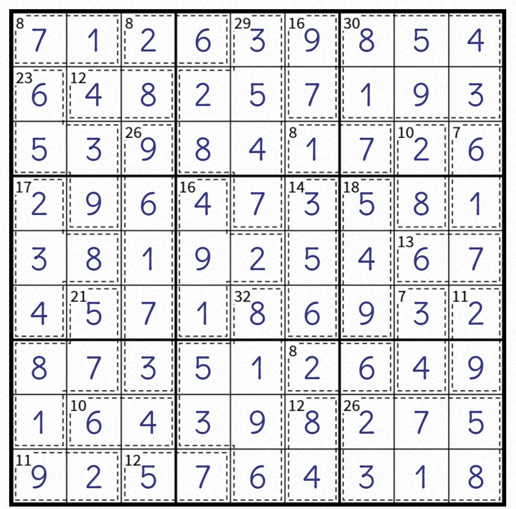

# killer-sudoku-skill（杀手数独 AI 解题技能）

**GitHub 上现有的 killer sudoku 仓库全是"程序求解器"——代码自己暴力算答案；这个是 AI Agent Skill：教 AI 像人一样推理解题**（笼子组合、45法则、区域拆分），并且只交付人类能跟着抄的解题过程，不甩机器答案。



## 能做什么

| 能力 | 说明 |
|---|---|
| 题目核对 | 81 格、笼子总和 405、格子不重叠，自动校验 |
| 45法则全量扫描 | 27 个单区域 + 任意连通区域组合（可到 6 个以上）全枚举，输出"直接锁定 / 幽灵笼子 / 化简关系式"，并生成可交互的盘面高亮 HTML 图（悬停高亮对应格子和区域） |
| 人类逻辑逐步求解 | 只用人类招法：45法则 → 唯一组合 → 显性/隐性数对 → 指向 → 线性消元（分数精确运算）→ 反证法兜底，输出编号步骤单 |
| 步骤验真 | 独立求解拿真解，逐步回放步骤单，揪出任何一步错误，保证 0 错误才交付 |
| 大白话交付 | 最终输出"照抄版"：在哪写几 + 一句话原因，连锁数字直接列格子=数字 |
| 截图录题 | 附带网页录入工具：导入题目截图，鼠标拖选建笼子，导出标准 JSON |

## 快速上手（自带示例题）

不用自己找题，`examples/` 里有一道真实题目和验过真的完整步骤单：

```bash
python scripts/human_solve.py examples/killer4.json                        # 求解，生成编号步骤单
python scripts/replay_check.py examples/killer4.json examples/killer4_steps.txt   # 步骤验真
```

预期结果：139 步、0 错误，解盘在 `examples/killer4_steps.txt` 末尾。

## 安装

clone 本仓库（或下载 zip 解压），把文件夹重命名为 `killer-sudoku/`，放进 AI 助手的技能目录即可：

- **WorkBuddy**：`~/.workbuddy/skills/killer-sudoku/`
- **Claude Code 等兼容 SKILL.md 格式的助手**：放入对应的 skills 目录（本技能的 SKILL.md 采用通用 frontmatter 格式，`agent_created` 为 WorkBuddy 扩展字段，其他平台可忽略或删除）

依赖：Python 3.8+，无第三方库。

## 用法（对话内）

- 发来题目 JSON（`{"givens": [[9x9]], "cages": [{"sum": n, "cells": [[r,c],...]}]}`，0 基坐标）+ 说"今天这题，照老规矩" → 完整流程跑完，交付照抄版解题过程
- 说"今天这题，手把手" → 逐步带解，一步一格，每步因果给全
- 发题目截图 → 用附带的网页录入工具人工转成 JSON

## 文件结构

```
killer-sudoku/
├── SKILL.md              # 技能说明与工作流程
├── scripts/
│   ├── killer45_scan.py  # 45法则全量扫描器 + 盘面高亮图
│   ├── human_solve.py    # 人类逻辑逐步求解器
│   └── replay_check.py   # 步骤单重放验真（通用，自动求解真值）
├── references/
│   ├── output-format.md  # 输出规范：中文记号、照抄版格式、协作模式
│   └── techniques.md     # 技巧库：45法则/幽灵笼子/笼拆分等技巧与实现坑
├── examples/             # 自带示例题 + 已验真的完整步骤单
│   ├── killer4.json      # 题目（givens 全 0 + 27 个笼子，总和 405）
│   ├── killer4_steps.txt # 完整编号步骤单（139 步，replay_check 验真 0 错误）
│   └── README.md         # 示例说明
└── assets/
    └── killer-sudoku-input.html  # 截图录入工具（浏览器直接打开）
```

## 许可

MIT
